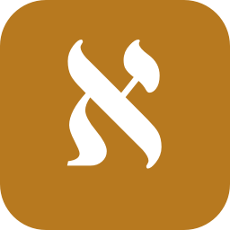

<p align="center">
  
</p>

<h1 align="center">Vocab</h1>

<p align="center">
  Learn the vocabulary of the Hebrew Bible from the words as they actually occur in the text.
</p>

<p align="center">
  <a href="https://github.com/ch-jensen/Vocab/releases/latest"><b>Download for Windows</b></a>
  · <a href="#licence">Licence</a>
  · <a href="desktop/README.md">For developers</a>
</p>

<p align="center">
  
</p>

Vocab is a vocabulary trainer for Biblical Hebrew and Aramaic. Instead of drilling dictionary forms,
it shows you a word **as it is written in a real verse**, with its prefixes, suffixes and vowels,
in its clause. You give the meaning, and Vocab works out when you should see the word again.

## The idea

**Knowing a word is not a yes-or-no matter.** A word is *active* when you have met it recently and
recognised it quickly and reliably; it becomes *inactive* when you haven't. Vocabulary practice is
therefore never finished, and the useful question is which words need your attention today.

Vocab answers that with three principles:

1. **Attested forms, not dictionary entries.** Every review shows a different occurrence of the
   word from the Hebrew Bible, so you learn to recognise וַיֹּאמֶר, לֵאמֹר and אָמַרְתָּ, not only
   the dictionary form אמר. Forms you haven't seen yet come first. That is the skill you need for
   reading the text.
2. **The most useful words first.** The predefined plan introduces words from the most to the least
   frequent. A few hundred words already cover most of the text: Vocab shows you how much of each
   book you can read with the words you know.
3. **Spaced repetition.** Words come back just before you would forget them. Vocab uses FSRS, the
   scheduling algorithm of [Anki](https://apps.ankiweb.net), and can fit it to your own memory.

The data comes from the [BHSA](https://github.com/ETCBC/bhsa) (Biblia Hebraica Stuttgartensia
Amstelodamensis, version 2021), the linguistic database of the Hebrew Bible made by the ETCBC.

## Getting started

1. **[Download the latest `VocabSetup-….exe`](https://github.com/ch-jensen/Vocab/releases/latest)** and run it.
   No Python or other software is needed, nor administrator rights.
   Windows may warn that the publisher is unknown, because the installer isn't code-signed:
   choose *More info* → *Run anyway*.
2. Click **New deck…** and keep *Biblical Hebrew by frequency* to start with the most common words,
   or make your own selection.
3. Click **Study**. Type the meaning and press Enter, or switch the deck to *show the answer and
   rate yourself*, as in Anki.

Your progress is saved automatically in `%APPDATA%\Vocab`. It is kept when you update or uninstall
the app. To update, install a newer version over the old one.

## How studying works

Each word is in one of three groups, shown at the top of the study screen (hover over them for an
explanation):

| | |
|---|---|
| **New** | Words you haven't seen yet, up to the deck's daily limit (10 by default). |
| **Learning** | Words you have just met or just forgotten. They come back after short steps (1 minute, then 10 minutes) until they *graduate*. The number in parentheses counts those coming back later today. |
| **Due** | Learned words whose interval (days, weeks, months) has run out, so they are up for review today. Forget one and it goes back to learning. |

When nothing is due, the session ends with *Finished for now*. Words still in learning come back
later the same day, and the app tells you when.

**Typed answers** accept any of the listed glosses, ignore text in parentheses and a leading "to",
and forgive small typos. They are rated by correctness and speed: a wrong answer counts as *Again*,
a slow or misspelt one as *Hard*, a quick one as *Easy*. In **self-graded mode** you show the answer
and choose Again, Hard, Good or Easy yourself (keys 1–4); the next word follows at once.

## Features

* **Decks.** Predefined plans for Hebrew and Aramaic, ordered by frequency, or your own selection
  by part of speech, frequency rank, verbal stem, tense, pronominal suffix, or book and chapters
  (for example the vocabulary of Jonah, or the verbs in the piel). Optionally, each verbal stem can
  be learned as a separate word. Progress is shared between decks.
* **Statistics.** How much of the text you know, overall and for each book; progress per deck;
  your reviews over the last 30 days and the words due in the next 30.
* **Personal scheduling.** After 400 reviews, FSRS can be fitted to your own answers, so intervals
  match how quickly *you* forget. The fit is only used if it predicts your answers better.
* **Glosses.** English (from the BHSA) and Danish glosses are included. Edit any gloss while
  studying, or import a `[Language]_glosses.csv` file to study with glosses in another language.
* **From the notebook version.** Progress saved by the notebook version (`English_score.csv`,
  `Danish_score.csv`) can be imported with *File → Import scores*.

Qere/ketiv cases are not asked about. The program runs on Windows 10 and 11 (64-bit). The source
code and build instructions are in [`desktop/`](desktop/README.md).

## Licence

Vocab is © 2020–2026 Christian Canu Højgaard and licensed under the
**[Creative Commons Attribution-NonCommercial 4.0 International licence (CC BY-NC 4.0)](https://creativecommons.org/licenses/by-nc/4.0/)**,
the licence of the BHSA 2021 data it is built on. See [LICENSE](LICENSE).

This means you may use, share and adapt Vocab freely, **but not commercially**, and you must give
appropriate credit, including to the BHSA:

> Data: BHSA (Biblia Hebraica Stuttgartensia Amstelodamensis), version 2021, by the Eep Talstra
> Centre for Bible and Computer (ETCBC), Vrije Universiteit Amsterdam, licensed under CC BY-NC 4.0.
> https://github.com/ETCBC/bhsa

The desktop app also includes the following components under their own licences:

| Component | Licence |
|---|---|
| [Ezra SIL](https://software.sil.org/ezra/) font, © SIL International | [SIL Open Font License 1.1](https://openfontlicense.org) |
| [py-fsrs](https://github.com/open-spaced-repetition/py-fsrs) and [fsrs-rs-python](https://github.com/open-spaced-repetition/fsrs-rs-python) | MIT |
| [Qt for Python (PySide6)](https://doc.qt.io/qtforpython/) | LGPL v3 |
| [Python](https://www.python.org) | Python Software Foundation License |

## The original notebook version

Vocab started in 2020 as a Jupyter notebook (`Vocabulary training.ipynb` with `Vocab.py`), using
[Text-Fabric](https://github.com/annotation/text-fabric) and its own spacing algorithm based on
response time, mistakes and time since the last answer. It is still in this repository and
works as before; the desktop app grew out of it. A user manual is in
`User manual Vocab 30.10.25.docx`.


To run it, install the requirements and open the notebook in Jupyter, with `Vocab.py` in the same
folder:

```
pip install text-fabric jupyter ipywidgets ipython
```

To practise with glosses other than the default English ones, add a file named
`[Language]_glosses.csv` (for example `German_glosses.csv`) in the layout of
[Danish_glosses.csv](Danish_glosses.csv) to the same folder. The same files can be imported into the
desktop app.

**History**

* Dec. 21 2020: First version, with English glosses and an algorithm that tracks learning and picks the words to practise.
* Feb. 11 2022: Glosses in other languages, and widgets for choosing the words to learn (e.g. verbal stem, tense).
* Oct. 31 2025: Small fixes.
* Jan. 5 2026: Average time added to the statistics; requirements file.
* Nov. 26 2026: Desktop app for Windows (version 0.1.0) with FSRS scheduling, decks, statistics and an installer.
